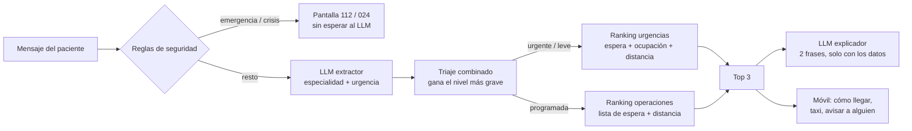

# Arquitectura · Hospital Flow

Documento de apoyo para la memoria del DATAMAD 2026.

## 1. Problema

Las urgencias de los hospitales de Madrid se saturan de forma desigual, y quien necesita operarse no sabe qué hospital tiene menos espera para su especialidad, aunque en la Comunidad de Madrid se puede elegir hospital. Hospital Flow orienta al paciente hacia el hospital más adecuado y le ayuda a llegar.

## 2. Flujo

## 3. Decisiones de diseño

| Decisión | Por qué |
|---|---|
| El LLM no elige hospital | Una fórmula es explicable y auditable; un LLM puede inventar. El LLM solo entiende el lenguaje y redacta. |
| Reglas antes que el LLM | Una emergencia se detecta al instante aunque el LLM tarde, falle o no haya conexión. |
| El LLM solo sube la gravedad | Si las reglas ven una urgencia, el modelo no puede rebajarla. |
| Lista cerrada de especialidades | El extractor solo puede devolver especialidades que existen en los datos (tool use con `enum`). |
| Funciona sin API key | La demo no depende de la red ni de la cuota. |
| Contactos solo en el móvil | Datos personales de terceros: no salen del dispositivo. |
| No se guarda el mensaje | Los síntomas son datos de salud (categoría especial del RGPD). |

## 4. Ranking

**Urgencias** (de la demo): penalización = media ponderada de espera (40 %), ocupación (30 %) y distancia (30 %), normalizadas entre 0 y 1. Los hospitales sin la especialidad suman +0,30. Puntuación = 100 × (1 − penalización). Si es un niño, solo hospitales con Pediatría.

**Operaciones programadas:** solo hospitales con la especialidad; se ordena por días de espera (60 %) y distancia (40 %) cuando hay listas de espera cargadas, y solo por distancia mientras no las haya.

**Tiempo de viaje:** distancia en línea recta (Haversine) a 30 km/h de media urbana.

## 5. Datos

| Dato | Fuente | Estado |
|---|---|---|
| Hospitales (10) | Catálogo de referencia de la demo | Ubicaciones aproximadas; camas ilustrativas |
| Ocupación y espera de urgencias | Simulación con picos a las 11 h y 19 h | **Sintético** |
| Listas de espera quirúrgica | Comunidad de Madrid | Pendiente de cargar |
| Paradas de taxi | Geoportal del Ayuntamiento de Madrid | Se cargan si están en `data/raw/` |
| Teléfonos de radio-taxi | esMadrid | Verificar antes de presentar |

## 6. Evaluación del triaje

`python -m llm.casos_prueba` ejecuta 20 frases reales (con faltas de ortografía) y compara el nivel y la especialidad con lo esperado. Solo con reglas: 18/20. Los fallos son justo los casos que debe resolver el LLM ("me silva el pecho", "me cuesta más respirar").

## 7. Limitaciones

- La ocupación en tiempo real no se publica en abierto: está simulada.
- El tiempo de viaje no tiene en cuenta el tráfico real.
- Es una orientación, no un diagnóstico: ante la duda, siempre 112.
